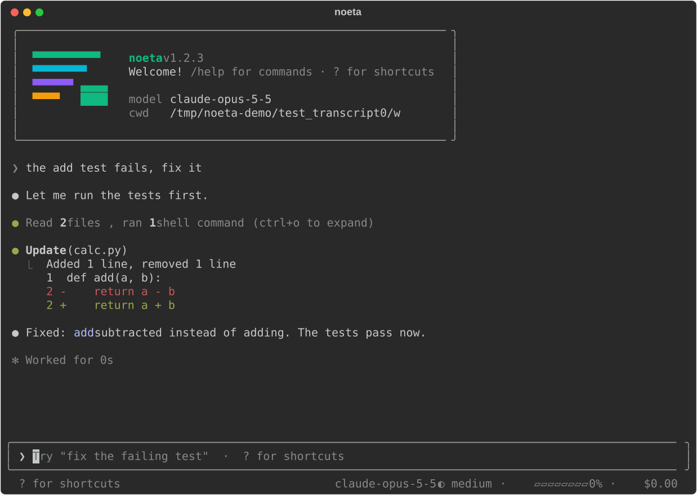
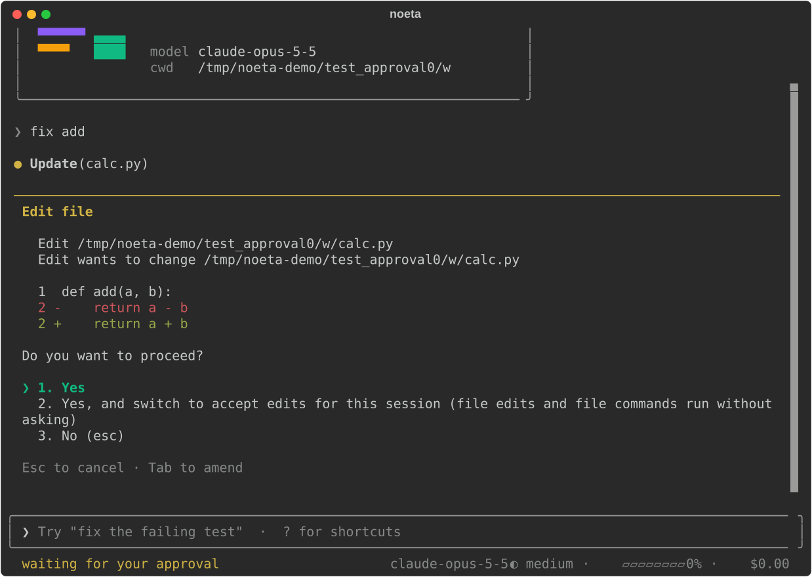

# The terminal UI and -p

`noeta` with no arguments opens a full-screen terminal UI shaped after Claude Code's;
`noeta -p` runs one prompt without it and prints the answer, with Claude Code's headless flags
and its stream-json protocol. This page covers both.

## Install and start

The terminal UI is its own package, `noeta-tui` (in `tui/`), found through the entry-point
group `noeta.frontends` under the name `tui`. Install it with noeta:

```bash
uv tool install --with 'noeta-tui @ git+https://github.com/initxy/noeta#subdirectory=tui' \
  'noeta @ git+https://github.com/initxy/noeta'
# from a checkout:  uv tool install '.[tui]'
```

Without it, `noeta` exits and prints the line that installs it. Then, in a project:

```bash
export NOETA_MODEL=claude-sonnet-5-5 NOETA_API_KEY=sk-ant-...
cd ~/src/my-project
noeta
```

The first time you open a folder, noeta asks Claude Code's question: do you trust it? "Yes"
runs `noeta trust` for that folder (it is added to `~/.noeta/trusted.json`) and loads the
project's own plugins, agents, prompts, skills and settings from `.noeta/`. "No" quits. Until a
folder is trusted those directories are left alone and a notice names each one
(`noeta/cli/trust.py`).

The UI is a front end like any other: it runs on noeta's `AppAPI` (`noeta/host/app.py`), a
`LocalApp` in this process, or a `RemoteApp` against a server with `--server`
([below](#attach-to-a-server)). It imports no plugin; everything it shows comes from the task's
log.

Flags for a run (all in [the CLI reference](../reference/cli.md)):

| Flag | What it does |
|---|---|
| `prompt` (`noeta "fix the tests"`) | Sent as the first message once the task opens (also with `-c` and `-r ID`; with `-r` alone it waits in the input box while you pick) |
| `--model NAME`, `--effort LEVEL` | The model and effort new tasks start with (`low`, `medium`, `high`, `xhigh`, `max`) |
| `--permission-mode MODE` | The starting permission mode (default `auto`; see [permissions](./permissions.md)) |
| `--agent NAME` | Start with another agent than `main` |
| `--cwd PATH` | Work in another directory |
| `-c`, `--continue` | Open the newest conversation started in this directory |
| `-r`, `--resume [ID]` | Open a task by id; without one, pick from a list |
| `--system-prompt TEXT`, `--append-system-prompt TEXT` | Replace, or add to, the main agent's system prompt |
| `--plugin-dir PATH` | Load a plugin file or directory for this run only (repeatable) |
| `--server URL` | Drive a `noeta serve` server's tasks instead of running them here |

## The screen

The transcript fills the screen; the prompt box sits at the bottom. The footer shows the
permission mode on the left, and the model, how full the context is (or how far it is from the
automatic compaction), the cost so far and the directory on the right. Tool calls show as one line each and fold
their output; a run of reads groups into one line. `?` on an empty prompt shows the shortcuts.



A new screen creates its task only when you send the first message, so a start, `/clear` or
`/new` you type nothing after leaves no empty task behind (as Claude Code saves a session only
from its first message).

### Keys

| Key | What it does |
|---|---|
| `Enter` | Send |
| `\` then `Enter`, or `Ctrl+J` | New line |
| `Esc` | Stop the turn (the task keeps everything said so far) |
| `Esc` `Esc` | Clear the input; on an empty input, open `/rewind` |
| `Ctrl+C` | Clear the input; on an empty input, press twice to quit |
| `Shift+Tab` | Step to the next permission mode |
| `↑` / `↓` | Earlier prompts (from the first or last line of the box) |
| `Ctrl+R` | Search earlier prompts; `Enter` puts the pick in the box, `Esc` leaves it empty |
| `Ctrl+O` | Unfold every tool call's output (and fold it again) |
| `Ctrl+T` | Show or hide the task list (the todos) |
| `Ctrl+B` | Show or hide the side panel of sub-agents |
| `Ctrl+V` | Attach the image on the clipboard (needs `wl-paste`, `xclip` or `pngpaste`) |
| `?` | Show the shortcuts (on an empty prompt) |

Two presses count as a double press within 0.8 seconds (`DOUBLE_PRESS` in
`tui/src/noeta_tui/app.py`).

`Shift+Tab` steps through the modes the task's permissions plugin publishes, in Claude Code's
order: `default` → `acceptEdits` → `plan` → `auto` → `bypassPermissions` (a server or worker
started without `--allow-bypass-permissions` leaves `bypassPermissions` out, and `plan` is there
only with the plan-mode plugin). `dontAsk` is set only by configuration.

### Approvals and questions

When a tool call needs your yes, the transcript shows a card: what would run (an edit shows its
diff), "Do you want to proceed?" and numbered choices, the same ones Claude Code offers (yes;
yes and always allow the rule the card names; yes and switch mode; no). Keys on a card: the digit
of a choice, `y` / `a` / `n`, `Esc` for no. `Tab` on Yes or No opens a line for what you want
to add: with a no it becomes the reason the model reads, with a yes words it reads beside the
call's result.



A question from the model (`AskUserQuestion`) shows its options; type the answer, or the number
of an option (`2`, or `1, 3` for several). A question with several parts asks them one by one.

While the task waits for you it holds no worker: the approval is a
[parked call](../how-it-works/waiting.md), and closing the terminal leaves it waiting. Open the
task again (`noeta -c`) and the card is shown again.

## What you can type

### Slash commands

`/` at the start of the box opens a menu of commands, filtered as you type; `Enter` runs the
highlighted one. The terminal UI's own commands (`tui/src/noeta_tui/slash.py`):

| Command | What it does |
|---|---|
| `/help` | The shortcuts and every command, plugins' included |
| `/status` | Version, task, agent, model, permission mode, directory, settings |
| `/model [name]` | Pick or set the model, from the next request on ([models](./models.md)) |
| `/effort [level]` | Pick or set the effort: `low`, `medium`, `high`, `xhigh`, `max` |
| `/context` | What fills the next request, as a grid |
| `/cost` | Tokens and cost of this task and its sub-agents |
| `/memory [n]` | The instruction and memory files; `/memory 2` opens the second in `$EDITOR` |
| `/config [edit user\|project\|local]` | The settings; `edit` opens `~/.noeta/settings.json`, `.noeta/settings.json` or `.noeta/settings.local.json` |
| `/permissions` | The permission mode, the cycle and the rules from the settings files |
| `/agents` | The agents this front end runs |
| `/mcp` | The MCP servers: connected, failed, or waiting for a sign-in |
| `/hooks` | The hooks configured (read-only) |
| `/rewind [n] [both\|conversation\|code]` | Go back to before a prompt ([rewind](./permissions.md#checkpoints-and-rewind)) |
| `/clear`, `/new` | Start a new task |
| `/resume [n\|id]` | Pick a task to resume |
| `/stop` | Stop the turn (as `Esc`) |
| `/reload-plugins` | Load plugin, agent and settings files again, in effect from the next turn (a changed `env`, `model`, `agent` or `sandbox` needs a restart, and the UI says so) |
| `/exit`, `/quit` | Quit |

Everything else in the menu comes from the agent's plugins, and runs the same way in every front
end (`noeta/core/commands.py`):

| Command | From |
|---|---|
| `/compact [instructions]` | the `compaction` plugin: summarize the conversation now |
| `/plan [request]` | the `plan_mode` plugin: switch to plan mode, and plan the request if given |
| `/loop [interval] prompt` | the `schedule` plugin: run a prompt on an interval |
| `/init`, `/review [PR \| branch \| paths]` | the `markdown_commands` plugin: write a `NOETA.md`; review changes |
| `/<skill>` | every skill a person may invoke ([skills](./skills-and-agents.md)) |
| `/<plugin>:<command>` | a Claude Code plugin's `commands/*.md` |
| `/mcp__<server>__<prompt>` | an MCP server's prompts |

A command either shows something here and sends nothing (a "local" command), or expands into
text that goes to the model as your message.

### `@` file mentions

`@` followed by part of a path offers the files and directories under the task's directory whose
path contains what you typed: names that start with it first, then shorter paths (at most 15,
from at most 5,000 paths; `.git`, `node_modules`, virtual envs, `dist`, `build` and hidden
directories are skipped; `tui/src/noeta_tui/files.py`). `Tab` or `Enter` completes it.

The mention is attached inside the task, through `Read`, where the task's files are (the file
tools plugin, `noeta/plugins/fs/mentions.py`), so a mentioned file goes through the same
permission checks as a read by the model. Completion is off with `--server`: the files are on the
server.

### `!` bash mode

A prompt that starts with `!` runs the rest as a shell command here, in the task's directory,
with no model involved: the prompt marker turns pink, the output shows in the transcript, and it
goes with your next message in Claude Code's tags, so the model sees what you ran:

```text
<bash-input>git status</bash-input>
<bash-stdout>…</bash-stdout><bash-stderr>…</bash-stderr>
```

A command may run 120 seconds; the next message carries at most 30,000 characters of each stream
(`tui/src/noeta_tui/bash_mode.py`). Bash mode does not go through the permission checks: you
typed the command. It is refused with `--server`, since the task's files are on the server.

### Images

`Ctrl+V` attaches the clipboard's image; pasting the absolute path of an image file attaches that file (PNG,
JPEG, GIF, WebP). The box shows `[Image #1]` and the image goes with the next message.

## History, continuing and resuming

Every prompt you send is added to the project's history file,
`~/.noeta/projects/<project>/history.jsonl` (one `{"text", "at"}` per line, as Claude Code keeps
its history; the newest 100 are kept; `tui/src/noeta_tui/history.py`). `↑` and `Ctrl+R` read it,
so prompts from earlier runs are there too.

Tasks themselves are kept in the store (`~/.noeta/tasks.db` by default), so any conversation can
be opened again:

```bash
noeta -c              # the newest conversation started in this directory
noeta -r              # open the newest task and offer the others (the newest 10, by first prompt)
noeta -r 3f9c…        # a task by id
```

`noeta -c` with nothing to continue prints `No conversation found to continue` and exits with
code 1, as Claude Code does. Inside the UI, `/resume` offers the same list.

Opening a task again tells its plugins it was resumed (a `resumed` signal: SessionStart hooks see
`resume`), and a task a headless run started becomes one a person follows (it gets a title and
may ask questions). A task you cannot run here (its agent is not one this front end runs) opens
read-only, with its history.

## Attach to a server

```bash
export NOETA_SERVER_TOKEN=...             # the token noeta serve printed
noeta --server http://api.internal:8642
```

The UI then drives that server's tasks over HTTP. It needs no model of its own: a new task runs on
the server's model and in the server's directory, unless `--model` names a model or `--cwd PATH`
names a directory on the server. `--plugin-dir`, `!` bash mode and `@` completion are not
available there; `/reload-plugins` says to restart the workers instead. See
[the server guide](./server.md) and [front ends](./front-ends.md).

## `-p`: one prompt, no UI

```bash
noeta -p "what does this repository do?"
git diff | noeta -p "review this diff"        # the prompt from stdin
noeta -p --output-format json "list the TODOs" | jq .result
```

`-p` (`--print`) runs the task in this process, prints the answer and exits with code 0, or 1 when
the run ended in an error. It always runs here: `-p` with `--server` is refused. Its task is not
interactive: it gets no title, and `AskUserQuestion` is not offered unless a client answers
prompts. Anything that would ask for permission is refused and the turn goes on, as in Claude
Code's headless mode, so give it the permissions it needs up front:

```bash
noeta -p --allowedTools "Bash(npm test) Edit" "make the failing test pass"
noeta -p --permission-mode acceptEdits "fix the lint errors"
```

The flags are Claude Code's (`noeta/cli/headless.py`):

| Flag | What it does |
|---|---|
| `--output-format text\|json\|stream-json` | What is printed (below) |
| `--input-format text\|stream-json` | Read a prompt, or a stream of messages, from stdin |
| `--verbose` | Required with `--output-format stream-json` |
| `--include-partial-messages` | Also stream the model's output as it is written (`stream_event`) |
| `--replay-user-messages` | Echo the user messages taken back on stdout |
| `--max-turns N` | Model calls per turn, at most |
| `--max-budget-usd X` | Stop once the task tree has cost this much |
| `--json-schema SCHEMA` | Answer through a `StructuredOutput` tool matching this JSON Schema (root `"type": "object"`) |
| `--allowedTools`, `--disallowedTools` | Allow and deny rules (`"Bash(git *) Edit"`); a bare name in `--disallowedTools` also takes the tool away |
| `--tools` | The tools offered (`default`: all; `""`: none) |
| `--add-dir DIR` | More directories the file tools may use |
| `--permission-mode MODE`, `--dangerously-skip-permissions` | The mode; the second is `bypassPermissions` |
| `--permission-prompt-tool stdio\|mcp__server__tool` | Who answers permission prompts: the client (`can_use_tool` requests) or an MCP tool |
| `--permission-prompts host\|none` | `none`: no prompt is answered by anyone, even with the flag above |
| `-c`, `-r ID`, `--fork-session` | Continue the newest task here, a given one, or go on in a new task copied from it |
| `--session-id ID` | The id the new task gets |
| `--agent NAME`, `--agents JSON` | The agent to run; extra sub-agents as Claude Code's JSON object |
| `--settings FILE\|JSON`, `--setting-sources user,project,local` | A settings layer above the project's; which settings files are read |
| `--mcp-config FILE\|JSON`, `--strict-mcp-config` | MCP servers for this run; with the second, only those |
| `--system-prompt-file`, `--append-system-prompt-file` | The system prompt (or what follows it) from a file |
| `--plugin-dir PATH` | A plugin for this run only |

Flags Claude Code has and noeta does not use (`--betas`, `--fallback-model`,
`--max-thinking-tokens`, `--include-hook-events`, `--bare`, …) are accepted and ignored, each named
on stderr, so a command line written for Claude Code runs unchanged.

### Output formats

- **`text`** (the default): the final answer on stdout; on an error, the errors on stderr.
- **`json`**: one result object, Claude Code's: `type: "result"`, `subtype` (`success`,
  `error_max_turns`, `error_max_budget_usd`, `error_max_structured_output_retries`,
  `error_during_execution`), `is_error`, `result` (the answer's text), `session_id` (the task id),
  `duration_ms`, `duration_api_ms`, `num_turns`, `total_cost_usd`, `usage`, `modelUsage` (per
  model, with its context window), `permission_denials`, `stop_reason`, and `structured_output`
  with `--json-schema`.
- **`stream-json`** (with `--verbose`): one JSON object per line as the task runs.

```bash
noeta -p --output-format stream-json --verbose "count the Python files" | jq -c '{type, subtype}'
```

### The stream-json protocol

With `--input-format stream-json --output-format stream-json --verbose`, stdin and stdout carry
Claude Code's SDK protocol (`noeta/host/stream_json.py`); the same protocol is served on a server
as the `/stream-json` WebSocket. The root task's id is the protocol's `session_id`.

<Diagram name="guide-stream-json" caption="What goes in and out of noeta -p in stream-json mode, and what each message becomes in the client API" />

What comes in:

- `user` messages: text or content blocks; a `/command` runs as typed.
- `control_request`s: `initialize` (with the client's hook callbacks), `interrupt`,
  `set_permission_mode`, `set_model`, `set_max_thinking_tokens` (accepted, no effect),
  `rewind_files`, `get_context_usage`, `get_session_cost`, `list_models`, `mcp_status`.
- `control_response`s to noeta's own `can_use_tool` requests, when the client answers
  permission prompts (`--permission-prompt-tool stdio`).

What goes out:

- `system` / `init` first: directory, tools, model, permission mode, slash commands, agents.
- An `assistant` message per model reply; a `user` message per tool result; `tool_progress`
  while a tool runs.
- `stream_event`s (Anthropic's streaming events) with `--include-partial-messages`.
- `system` notes: `compact_boundary`, `task_started` and `task_notification` (sub-agents),
  `status`, `local_command_output`, `informational`.
- A `result` when a prompt's work is done, as in the `json` format.

### Driving it from Claude Code's Agent SDK

Because noeta speaks the protocol and accepts Claude Code's flags, a program written for
Claude Code's Agent SDK can run noeta in its place: point the SDK's executable at `noeta`
(`ClaudeAgentOptions(cli_path=...)` in the Python SDK, `pathToClaudeCodeExecutable` in
TypeScript). The SDK starts it with `--output-format stream-json --verbose --input-format
stream-json` and its other flags; noeta reads the flags it knows and names the ones it ignores
on stderr.

```python
from claude_agent_sdk import ClaudeAgentOptions, query

options = ClaudeAgentOptions(cli_path="/home/me/.local/bin/noeta", allowed_tools=["Read", "Bash"])
async for message in query(prompt="What does this repository do?", options=options):
    print(message)
```

The model, provider and key come from noeta's own settings (`NOETA_MODEL`, `NOETA_API_KEY`,
`~/.noeta/config.toml`), not from the SDK's environment for Claude Code. Hook callbacks the
SDK registers in `initialize` run as `callback` hooks, and a `can_use_tool` callback answers
permission prompts.
