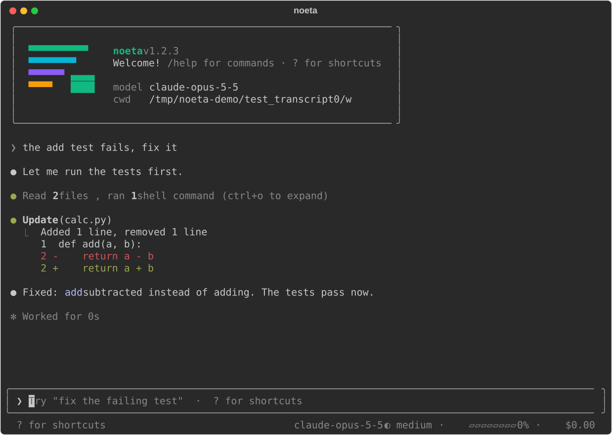
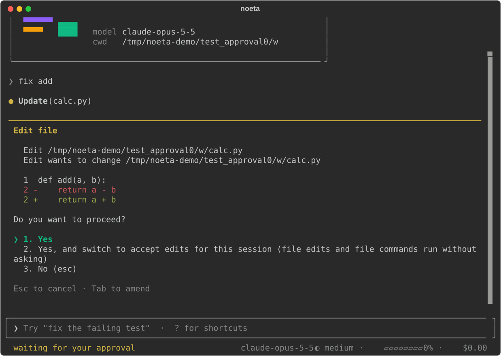

# 终端界面与 -p

不带参数运行 `noeta`，打开一个仿照 Claude Code 的全屏终端界面；`noeta -p` 不开界面，跑一句提问、打印答案就退出，命令行参数和 stream-json 协议都和 Claude Code 的无界面模式一样。本页两样都讲。

## 安装和启动

终端界面是单独的包 `noeta-tui`（在仓库的 `tui/` 里），noeta 通过入口点组 `noeta.frontends` 里名叫 `tui` 的条目找到它。它和 noeta 一起发布、版本号相同，装 `tui` 这个 extra 就会带上：

```bash
uv tool install 'noeta[tui]'      # 或者：pip install 'noeta[tui]'
# 从源码目录装：  uv tool install '.[tui]'
```

没装的话，`noeta` 会退出，并打印出安装它的那行命令。装好后在项目里运行：

```bash
export NOETA_MODEL=claude-sonnet-5-5 NOETA_API_KEY=sk-ant-...
cd ~/src/my-project
noeta
```

第一次打开某个目录，noeta 会问 Claude Code 那个问题：你信任这个目录吗？选"是"等于对这个目录执行 `noeta trust`（记进 `~/.noeta/trusted.json`），然后加载项目 `.noeta/` 下自己的插件、代理、提示词、技能和设置；选"否"直接退出。目录没被信任之前，这些子目录一律不碰，每跳过一个都会提示一句（`noeta/cli/trust.py`）。

终端界面和其他前端没有区别：它跑在 noeta 的 `AppAPI`（`noeta/host/app.py`）上，要么是本进程里的 `LocalApp`，要么是用 `--server` 连到服务器的 `RemoteApp`（见[下文](#连到服务器)）。它不引用任何插件，界面上显示的一切都从任务日志读出来。

这次运行可用的参数（完整列表见 [CLI 参考](../reference/cli.md)）：

| 参数 | 作用 |
|---|---|
| `prompt`（`noeta "把测试修好"`） | 任务打开后作为第一条消息发出（`-c`、`-r ID` 也一样；只写 `-r` 时先留在输入框里，等你挑好任务） |
| `--model NAME`、`--effort LEVEL` | 新任务用的模型和推理强度（`low`、`medium`、`high`、`xhigh`、`max`） |
| `--permission-mode MODE` | 起始权限模式（默认 `auto`，见[权限](./permissions.md)） |
| `--agent NAME` | 用 `main` 以外的代理开始 |
| `--cwd PATH` | 换一个工作目录 |
| `-c`、`--continue` | 打开在这个目录里开始的最新一次对话 |
| `-r`、`--resume [ID]` | 按 id 打开任务；不给 id 就从列表里挑 |
| `--system-prompt TEXT`、`--append-system-prompt TEXT` | 替换主代理的系统提示词，或在后面追加 |
| `--plugin-dir PATH` | 只在这次运行里加载一个插件文件或目录（可重复） |
| `--server URL` | 不在本地跑，改为操作某个 `noeta serve` 服务器上的任务 |

## 界面

对话记录占满屏幕，输入框在底部。底栏左边是权限模式，右边是模型、上下文用了多少（快到自动压缩时改成显示还差多少）、目前的花费和工作目录。每次工具调用占一行，输出默认折叠；连续几次读文件合成一行。输入框为空时按 `?` 显示快捷键。



新开的界面要等你发出第一条消息才真正创建任务，所以打开后、或者 `/clear`、`/new` 之后什么都没输入，就不会留下空任务（Claude Code 也是从第一条消息才开始保存会话）。

### 快捷键

| 按键 | 作用 |
|---|---|
| `Enter` | 发送 |
| `\` 再 `Enter`，或 `Ctrl+J` | 换行 |
| `Esc` | 停止这一轮（已经说过的内容都保留） |
| `Esc` `Esc` | 清空输入框；输入框已空时打开 `/rewind` |
| `Ctrl+C` | 清空输入框；已空时连按两次退出 |
| `Shift+Tab` | 切到下一个权限模式 |
| `↑` / `↓` | 翻之前的提问（光标在第一行或最后一行时） |
| `Ctrl+R` | 搜索之前的提问；`Enter` 把选中的放进输入框，`Esc` 留空 |
| `Ctrl+O` | 展开所有工具调用的输出（再按一次折叠） |
| `Ctrl+T` | 显示或隐藏任务清单（todos） |
| `Ctrl+B` | 显示或隐藏子代理侧栏 |
| `Ctrl+V` | 贴上剪贴板里的图片（需要 `wl-paste`、`xclip` 或 `pngpaste`） |
| `?` | 显示快捷键（输入框为空时） |

两次按键间隔在 0.8 秒内算连按（`tui/src/noeta_tui/app.py` 里的 `DOUBLE_PRESS`）。

`Shift+Tab` 按 Claude Code 的顺序在任务的权限插件公布的模式之间切换：`default` → `acceptEdits` → `plan` → `auto` → `bypassPermissions`。服务器或工人启动时没加 `--allow-bypass-permissions`，就不会出现 `bypassPermissions`；没有规划模式插件就不会出现 `plan`。`dontAsk` 只能通过配置设置。

### 审批和提问

工具调用需要你同意时，对话里会出现一张卡片：要执行什么（改文件的会附上 diff）、"Do you want to proceed?" 和几个带编号的选项，和 Claude Code 给的一样（同意；同意并且以后对卡片上那条规则不再询问；同意并切换模式；拒绝）。卡片上可以按选项的数字，也可以按 `y` / `a` / `n`，`Esc` 等于拒绝。光标在"是"或"否"上时按 `Tab`，会多出一行让你补充：拒绝时这段话就是模型读到的理由，同意时模型会在调用结果旁边读到它。



模型提问（`AskUserQuestion`）时会列出选项；直接输入答案，或输入选项编号（`2`，多选用 `1, 3`）。有几个小问题的会一个一个地问。

任务等你回答期间不占用任何工人：这次调用是[挂起](../how-it-works/waiting.md)的，关掉终端它也还在等。重新打开任务（`noeta -c`），卡片会再出现。

## 能输入什么

### 斜杠命令

在输入框开头打 `/`，会弹出命令菜单，边输边筛；`Enter` 执行高亮的那个。终端界面自己的命令（`tui/src/noeta_tui/slash.py`）：

| 命令 | 作用 |
|---|---|
| `/help` | 快捷键和所有命令，包括插件提供的 |
| `/status` | 版本、任务、代理、模型、权限模式、目录、设置 |
| `/model [name]` | 选择或直接设置模型，从下一次请求起生效（见[模型](./models.md)） |
| `/effort [level]` | 选择或设置推理强度：`low`、`medium`、`high`、`xhigh`、`max` |
| `/context` | 用方格图显示下一次请求里都装了什么 |
| `/cost` | 这个任务及其子代理用掉的 token 和花费 |
| `/memory [n]` | 列出项目说明文件和记忆文件；`/memory 2` 在 `$EDITOR` 里打开第二个 |
| `/config [edit user\|project\|local]` | 显示设置；`edit` 打开 `~/.noeta/settings.json`、`.noeta/settings.json` 或 `.noeta/settings.local.json` |
| `/permissions` | 权限模式、切换顺序，以及设置文件里的规则 |
| `/agents` | 这个前端能跑的代理 |
| `/mcp` | MCP 服务器：已连上、失败、还是在等登录 |
| `/hooks` | 已配置的 hook（只读） |
| `/rewind [n] [both\|conversation\|code]` | 回到某句提问之前（见[回退](./permissions.md#改动快照和回退)） |
| `/clear`、`/new` | 开一个新任务 |
| `/resume [n\|id]` | 挑一个任务接着做 |
| `/stop` | 停止这一轮（同 `Esc`） |
| `/reload-plugins` | 重新加载插件、代理和设置文件，从下一轮起生效（`env`、`model`、`agent`、`sandbox` 变了要重启，界面会提示） |
| `/exit`、`/quit` | 退出 |

菜单里其他命令都来自代理的插件，在每个前端里表现一致（`noeta/core/commands.py`）：

| 命令 | 来自 |
|---|---|
| `/compact [说明]` | `compaction` 插件：马上压缩对话 |
| `/plan [需求]` | `plan_mode` 插件：进入规划模式，给了需求就直接开始规划 |
| `/loop [间隔] 提问` | `schedule` 插件：按间隔反复执行一句提问 |
| `/init`、`/review [PR \| 分支 \| 路径]` | `markdown_commands` 插件：写一份 `NOETA.md`；审查改动 |
| `/<技能名>` | 每个允许人手动调用的技能（见[技能](./skills-and-agents.md)） |
| `/<插件>:<命令>` | Claude Code 插件里的 `commands/*.md` |
| `/mcp__<server>__<prompt>` | MCP 服务器提供的 prompt |

命令要么只在这里显示点东西、不发给模型（"本地"命令），要么展开成一段文字，当作你的消息发给模型。

### `@` 引用文件

`@` 后面跟路径的一部分，会列出任务目录下路径里包含这段文字的文件和目录：文件名以它开头的排前面，其次是路径短的（最多列 15 个，最多扫 5,000 个路径；`.git`、`node_modules`、虚拟环境、`dist`、`build` 和隐藏目录都跳过；`tui/src/noeta_tui/files.py`）。`Tab` 或 `Enter` 补全。

被引用的文件是在任务里通过 `Read` 附上的，也就是在任务文件所在的地方读（文件工具插件，`noeta/plugins/fs/mentions.py`），所以和模型自己读文件走同样的权限检查。用了 `--server` 时不做补全：文件在服务器上。

### `!` 直接执行命令

以 `!` 开头的输入，剩下的部分会作为 shell 命令直接在这里、在任务目录中执行，不经过模型：提示符变成粉色，输出显示在对话里，并按 Claude Code 的标签格式随你的下一条消息一起发出去，让模型知道你跑了什么：

```text
<bash-input>git status</bash-input>
<bash-stdout>…</bash-stdout><bash-stderr>…</bash-stderr>
```

命令最多跑 120 秒；下一条消息里每路输出最多带 30,000 个字符（`tui/src/noeta_tui/bash_mode.py`）。这种命令不走权限检查，因为是你亲手输入的。用了 `--server` 时会拒绝执行，因为任务的文件在服务器上。

碰到得你亲自在键盘上操作的命令（比如 `gcloud auth login` 这种交互式登录），模型会像 Claude Code 一样请你用 `! <命令>` 自己跑。做法是：终端界面给自己开的任务记上 `bash_mode: true`，主提示词里的这一行只有这些任务才有（用了 `--server` 时不记）。

### 图片

`Ctrl+V` 贴上剪贴板里的图片；粘贴一个图片文件的绝对路径，会把这个文件作为图片附上（PNG、JPEG、GIF、WebP）。输入框里显示 `[Image #1]`，图片随下一条消息发出。

## 输入历史、继续和恢复

你发出的每句提问都会记进这个项目的历史文件 `~/.noeta/projects/<project>/history.jsonl`（每行一个 `{"text", "at"}`，和 Claude Code 保存历史的方式一样；只保留最新的 100 条；`tui/src/noeta_tui/history.py`）。`↑` 和 `Ctrl+R` 读的就是它，所以以前几次运行里的提问也翻得到。

任务本身存在存储里（默认 `~/.noeta/tasks.db`），任何一次对话都能重新打开：

```bash
noeta -c              # 这个目录里最新的那次对话
noeta -r              # 打开最新的任务，并列出其他的（最新 10 个，按第一句提问显示）
noeta -r 3f9c…        # 按 id 打开
```

没有可继续的对话时，`noeta -c` 打印 `No conversation found to continue` 并以退出码 1 结束，和 Claude Code 一样。界面里的 `/resume` 给出同样的列表。

重新打开任务时会通知它的插件"被恢复了"（发一个 `resumed` 信号，SessionStart hook 看到的是 `resume`）；如果任务原先是无界面运行起来的，从此就变成有人在跟的任务（会起标题，也可以提问）。任务的代理不在这个前端能跑的范围内时，任务以只读方式打开，能看历史。

## 连到服务器

```bash
export NOETA_SERVER_TOKEN=...             # noeta serve 打印出来的令牌
noeta --server http://api.internal:8642
```

这时界面通过 HTTP 操作服务器上的任务。本机不需要配模型：新任务用服务器的模型、在服务器的目录里跑，除非 `--model` 指定了模型，或 `--cwd PATH` 指定了服务器上的某个目录。`--plugin-dir`、`!` 命令和 `@` 补全在这种模式下都不可用；`/reload-plugins` 会提示你去重启工人。详见[作为服务端运行](./server.md)和[网页、桌面与编辑器](./front-ends.md)。

## `-p`：只问一句，不开界面

```bash
noeta -p "what does this repository do?"
git diff | noeta -p "review this diff"        # 提问从 stdin 读
noeta -p --output-format json "list the TODOs" | jq .result
```

`-p`（`--print`）在本进程里跑任务，打印答案后退出；正常退出码 0，出错 1。它总是在本地跑：`-p` 加 `--server` 会被拒绝。这样的任务不算"有人在跟"：不起标题；除非有客户端负责回答，否则不提供 `AskUserQuestion`。任何需要问权限的调用都会被拒绝，这一轮接着往下走，和 Claude Code 的无界面模式一样，所以要事先给够权限：

```bash
noeta -p --allowedTools "Bash(npm test) Edit" "make the failing test pass"
noeta -p --permission-mode acceptEdits "fix the lint errors"
```

参数和 Claude Code 一致（`noeta/cli/headless.py`）：

| 参数 | 作用 |
|---|---|
| `--output-format text\|json\|stream-json` | 输出什么（见下文） |
| `--input-format text\|stream-json` | 从 stdin 读一句提问，或读一串消息 |
| `--verbose` | 配合 `--output-format stream-json` 必须加 |
| `--include-partial-messages` | 同时把模型正在写的输出流式发出（`stream_event`） |
| `--replay-user-messages` | 把收到的用户消息在 stdout 上回显 |
| `--max-turns N` | 每轮最多调用模型几次 |
| `--max-budget-usd X` | 整棵任务树花到这么多就停 |
| `--json-schema SCHEMA` | 通过 `StructuredOutput` 工具按这个 JSON Schema 作答（根必须是 `"type": "object"`） |
| `--allowedTools`、`--disallowedTools` | 放行和拒绝规则（`"Bash(git *) Edit"`）；`--disallowedTools` 里只写工具名的，会把工具整个拿掉 |
| `--tools` | 提供哪些工具（`default` 全部，`""` 一个都不给） |
| `--add-dir DIR` | 文件工具还可以用的目录 |
| `--permission-mode MODE`、`--dangerously-skip-permissions` | 权限模式；后者就是 `bypassPermissions` |
| `--permission-prompt-tool stdio\|mcp__server__tool` | 谁来回答权限请求：客户端（发 `can_use_tool` 请求），或某个 MCP 工具 |
| `--permission-prompts host\|none` | `none`：即使给了上一个参数，也没人回答权限请求 |
| `-c`、`-r ID`、`--fork-session` | 继续这个目录里最新的任务、继续指定任务，或复制它的对话到一个新任务里接着做 |
| `--session-id ID` | 新任务用的 id |
| `--agent NAME`、`--agents JSON` | 跑哪个代理；用 Claude Code 的 JSON 格式额外定义子代理 |
| `--settings FILE\|JSON`、`--setting-sources user,project,local` | 在项目设置之上再加一层设置；读哪些设置文件 |
| `--mcp-config FILE\|JSON`、`--strict-mcp-config` | 这次运行用的 MCP 服务器；加上后者就只用这些 |
| `--system-prompt-file`、`--append-system-prompt-file` | 从文件读系统提示词（或追加在它后面的部分） |
| `--plugin-dir PATH` | 只在这次运行里加载的插件 |

Claude Code 有、noeta 用不上的参数（`--betas`、`--fallback-model`、`--max-thinking-tokens`、`--include-hook-events`、`--bare` 等）照样接受、不起作用，每个都会在 stderr 上点名，所以为 Claude Code 写的命令行可以原样运行。

### 输出格式

- **`text`**（默认）：stdout 上只有最终答案；出错时错误信息打到 stderr。
- **`json`**：一个结果对象，格式同 Claude Code：`type: "result"`、`subtype`（`success`、`error_max_turns`、`error_max_budget_usd`、`error_max_structured_output_retries`、`error_during_execution`）、`is_error`、`result`（答案文本）、`session_id`（就是任务 id）、`duration_ms`、`duration_api_ms`、`num_turns`、`total_cost_usd`、`usage`、`modelUsage`（按模型分，带上下文窗口）、`permission_denials`、`stop_reason`，用了 `--json-schema` 时还有 `structured_output`。
- **`stream-json`**（要加 `--verbose`）：任务运行过程中，每行一个 JSON 对象。

```bash
noeta -p --output-format stream-json --verbose "count the Python files" | jq -c '{type, subtype}'
```

### stream-json 协议

用 `--input-format stream-json --output-format stream-json --verbose` 时，stdin 和 stdout 上走的是 Claude Code 的 SDK 协议（`noeta/host/stream_json.py`）；服务器上的 `/stream-json` WebSocket 提供的也是这个协议。协议里的 `session_id` 就是根任务的 id。

<Diagram name="guide-stream-json" caption="stream-json 模式下 noeta -p 的进出消息，以及每种消息对应的客户端接口调用" />

进来的消息：

- `user` 消息：文本或内容块；`/命令` 照常执行。
- `control_request`：`initialize`（带客户端的 hook 回调）、`interrupt`、`set_permission_mode`、`set_model`、`set_max_thinking_tokens`（接受但不起作用）、`rewind_files`、`get_context_usage`、`get_session_cost`、`list_models`、`mcp_status`。
- `control_response`：客户端负责回答权限请求时（`--permission-prompt-tool stdio`），对 noeta 发出的 `can_use_tool` 请求的回答。

出去的消息：

- 先发 `system` / `init`：目录、工具、模型、权限模式、斜杠命令、代理。
- 模型每回复一次发一条 `assistant`；每个工具结果发一条 `user`；工具运行期间发 `tool_progress`。
- 加了 `--include-partial-messages` 时发 `stream_event`（Anthropic 的流式事件）。
- `system` 通知：`compact_boundary`、`task_started` 和 `task_notification`（子代理）、`status`、`local_command_output`、`informational`。
- 一句提问的活干完后发一条 `result`，内容同 `json` 格式。

### 用 Claude Code 的 Agent SDK 来驱动

noeta 讲这套协议、认 Claude Code 的参数，所以为 Claude Code 的 Agent SDK 写的程序可以直接换成 noeta：把 SDK 的可执行文件指向 `noeta` 即可（Python SDK 里是 `ClaudeAgentOptions(cli_path=...)`，TypeScript 里是 `pathToClaudeCodeExecutable`）。SDK 会带着 `--output-format stream-json --verbose --input-format stream-json` 和其他参数启动它；noeta 用得上的参数照办，接受但用不上的在 stderr 上点名。

```python
from claude_agent_sdk import ClaudeAgentOptions, query

options = ClaudeAgentOptions(cli_path="/home/me/.local/bin/noeta", allowed_tools=["Read", "Bash"])
async for message in query(prompt="What does this repository do?", options=options):
    print(message)
```

模型、provider 和密钥来自 noeta 自己的设置（`NOETA_MODEL`、`NOETA_API_KEY`、`~/.noeta/config.toml`），而不是 SDK 给 Claude Code 准备的环境变量。SDK 在 `initialize` 里注册的 hook 回调会作为 `callback` 类型的 hook 运行，`can_use_tool` 回调负责回答权限请求。
